# Parth design taste visual references

This set pairs the written taste guidance with actual images of the work. It contains page captures from 7 November 2026 and original images from the inspected local project archive. Assembled 10 November 2026. The images are unmodified copies, not newly generated interpretations.

## How to use the images

Start with the company's existing product and supplied brand. For a new direction or substantial redesign, choose one or two images from the relevant branch below and open them with the available image viewer. V01 and V03 are useful starting anchors for an unbranded portfolio-like direction; they are not mandatory visual targets for every company. Reading captions alone does not load image pixels into context. For a narrow edit, inspect the current product first and open only references that resolve a real design choice. If image inspection is unavailable, use the annotations and state the visual-verification limit.

Before implementing, identify the specific trait being transferred and how it serves this project. In the rendered review, compare that trait with the reference while checking task clarity, reading, controls, and state behavior. Avoid matching incidental colors or furniture merely to make screenshots look alike.

All paths in the index are relative to this file. The [manifest](visual-manifest.json) records original paths, source pages, dimensions, capture metadata, classification, and SHA-256 hashes. Resolve the paths from the installed skill directory if a preview cannot display relative images. These copies remain available without the original audit folder or portfolio checkout.

## Choose references for the task

| Task | Open these references | Focus |
|---|---|---|
| New visual direction | Company references first, then the relevant branch; V01 and V03 for a portfolio-like brief | Character and hierarchy suited to the actual project |
| Product UI or dashboard | V03, V06, V07, V20, V21 | Hierarchy, density, state, and evidence |
| Editorial or portfolio page | V01, V02, V05, V19 | Type roles, composition, and purposeful variation |
| Physical or spatial experience | V11, V12, V13 | Input, construction, mechanism, and output |
| Typography or visual identity | V14, V15, V16 | A specific construction idea across a system |
| Expressive archive or playful experience | V17, V18 | A metaphor carried through the whole experience |
| Mobile adaptation | V06, V08, then C01–C03 | Scan hierarchy and the pitfalls to avoid |
| Exact portfolio reference values | [Foundations](foundations.md) | Source-backed color, type, spacing, and motion examples |

A direction reference supports the annotated trait, not every detail in its screenshot. Context images show range. Mood-only images are not usability targets. Before states support comparisons. Caution images record issues found in the earlier audit; they are not a claim about the current deployment.

## Image index

| ID | Image | Role |
|---|---|---|
| V01 | [home-desktop-light.png](images/home-desktop-light.png) | direction |
| V02 | [home-desktop-dark.png](images/home-desktop-dark.png) | direction |
| V03 | [mentra-desktop-light.png](images/mentra-desktop-light.png) | direction |
| V04 | [mentra-desktop-dark.png](images/mentra-desktop-dark.png) | direction |
| V05 | [work-desktop-light.png](images/work-desktop-light.png) | direction |
| V06 | [work-mobile-index-light.png](images/work-mobile-index-light.png) | direction |
| V07 | [mentra-decisions-desktop-light.png](images/mentra-decisions-desktop-light.png) | direction |
| V08 | [mentra-decisions-mobile-dark.png](images/mentra-decisions-mobile-dark.png) | direction |
| V09 | [raahi-desktop-light.png](images/raahi-desktop-light.png) | context |
| V10 | [transfi-desktop-light.png](images/transfi-desktop-light.png) | context |
| V11 | [jugalbandi-desktop-light.png](images/jugalbandi-desktop-light.png) | direction |
| V12 | [enigma-original-sculpture.webp](images/enigma-original-sculpture.webp) | original-project-image |
| V13 | [jugalbandi-original-mechanism.webp](images/jugalbandi-original-mechanism.webp) | original-project-image |
| V14 | [typeface-desktop-light.png](images/typeface-desktop-light.png) | context |
| V15 | [typeface-original-slice-types.jpg](images/typeface-original-slice-types.jpg) | original-project-image |
| V16 | [typeface-original-inspiration.jpg](images/typeface-original-inspiration.jpg) | original-project-image |
| V17 | [graveyard-desktop-light.png](images/graveyard-desktop-light.png) | direction |
| V18 | [graveyard-desktop-dark.png](images/graveyard-desktop-dark.png) | mood-only |
| V19 | [playbook-after-category-desktop-dark.png](images/playbook-after-category-desktop-dark.png) | context |
| V20 | [mentra-original-home-before.png](images/mentra-original-home-before.png) | before-state |
| V21 | [mentra-original-home-after.png](images/mentra-original-home-after.png) | original-project-image |
| C01 | [home-mobile-light.png](images/home-mobile-light.png) | caution |
| C02 | [playbook-mobile-light.png](images/playbook-mobile-light.png) | caution |
| C03 | [typeface-mobile-specimen-light.png](images/typeface-mobile-specimen-light.png) | caution |

## Annotated images

### Editorial direction

**V01 · home-desktop-light.png**

Large editorial type paired with plain supporting text; an object scene creates a second visual focus. Warm surrounding surfaces leave room for the content.

Study type roles and composition. Do not require this font, copy, hero height, background texture, or object network in another project. [Source page](https://designwhich.works/).

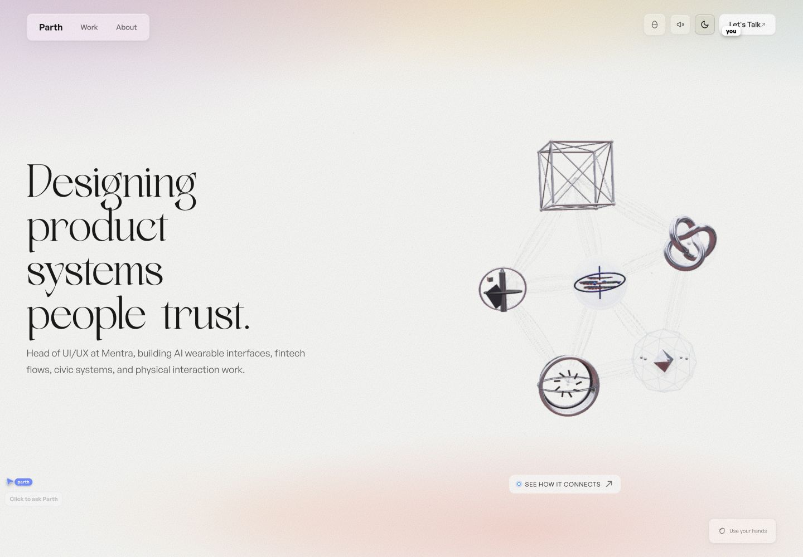

**V02 · home-desktop-dark.png**

The same editorial/object relationship survives a dark treatment. Neutral surroundings let the forms retain their material detail.

The assistant bubble overlaps content in this capture; its placement is not endorsed. Dark mode is a project decision. [Source page](https://designwhich.works/).

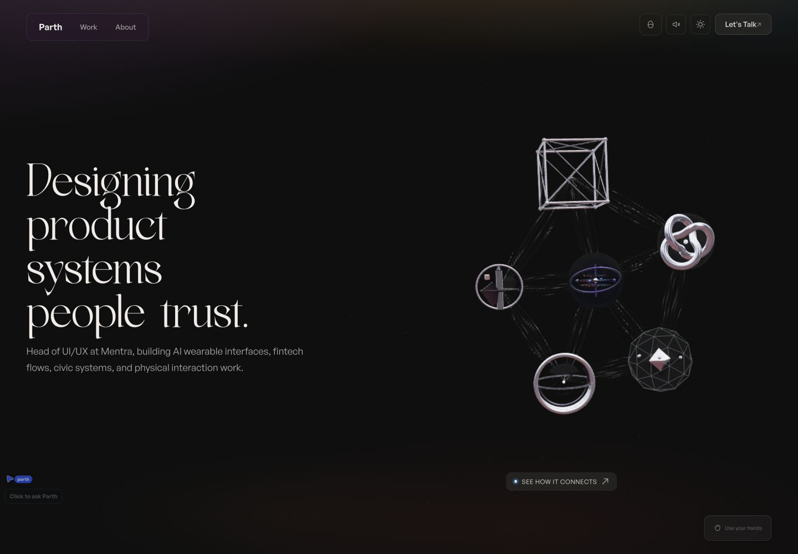

### Project framing and density

**V03 · mentra-desktop-light.png**

A quiet project frame gives the artifact most of the space. Plain project type, restrained metadata, and clear actions support the image.

The cover is identified as generated in the captured site. Treat it as presentation, not documentary proof of real-world use. [Source page](https://designwhich.works/mentra/).

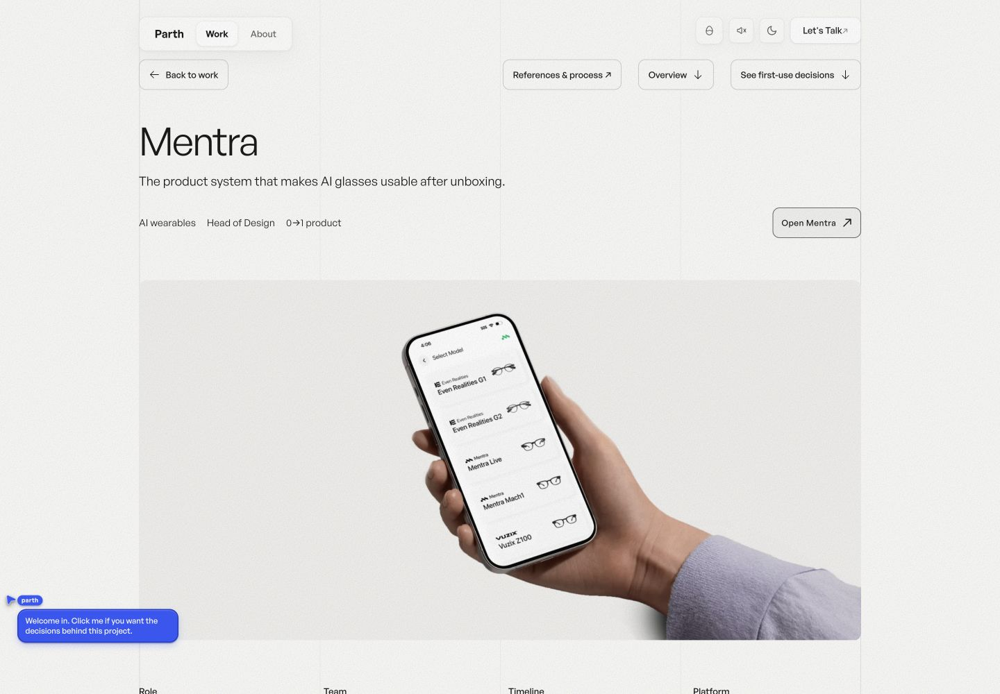

**V04 · mentra-desktop-dark.png**

Dark chrome preserves the original light media rather than recoloring the project artifact. The surrounding frame stays consistent.

Do not inherit every fixed control or assume a dark page requires darkening product screenshots. [Source page](https://designwhich.works/mentra/).

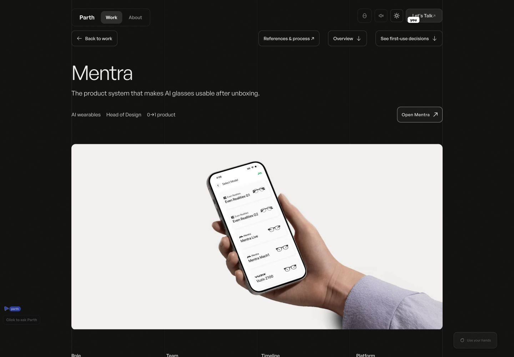

**V05 · work-desktop-light.png**

Large project imagery carries distinct identities inside a common index. Compact view controls offer a visible way to change browsing mode.

Card count, masonry arrangement, moving copy, and fixed filter position are site-specific. Use a stable summary in future listings. [Source page](https://designwhich.works/work/).

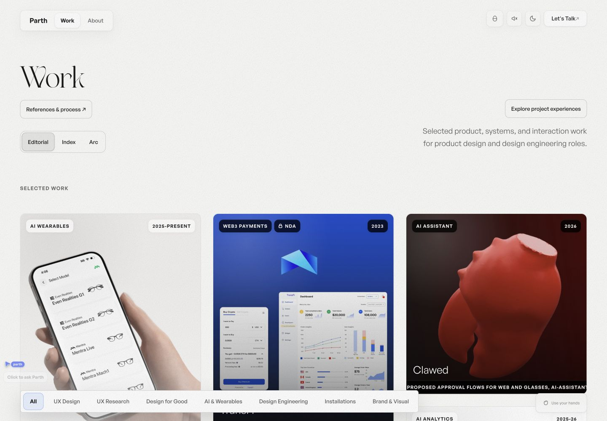

**V06 · work-mobile-index-light.png**

The compact index uses thumbnails, names, metadata, and short summaries for scanning on a small screen.

Use its scan hierarchy only when a collection needs it. Do not copy the number of modes or the amount of opening chrome. [Source page](https://designwhich.works/work?view=library).

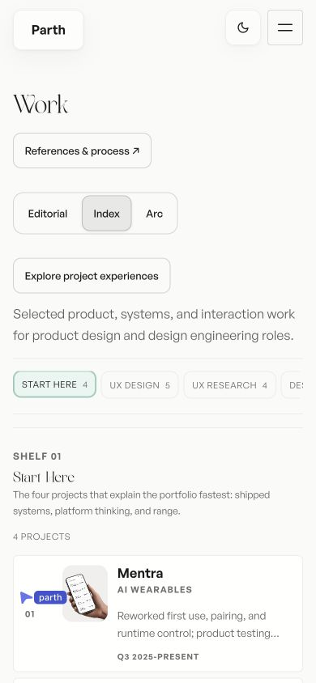

### Decision evidence

**V07 · mentra-decisions-desktop-light.png**

A before-and-after comparison is paired with the question, choice, and instructions for reading the screen.

The adjacent slide is partly visible and fixed tools remain present. Extract the evidence-and-explanation relationship, not the clipping or overlay. [Source page](https://designwhich.works/mentra/).

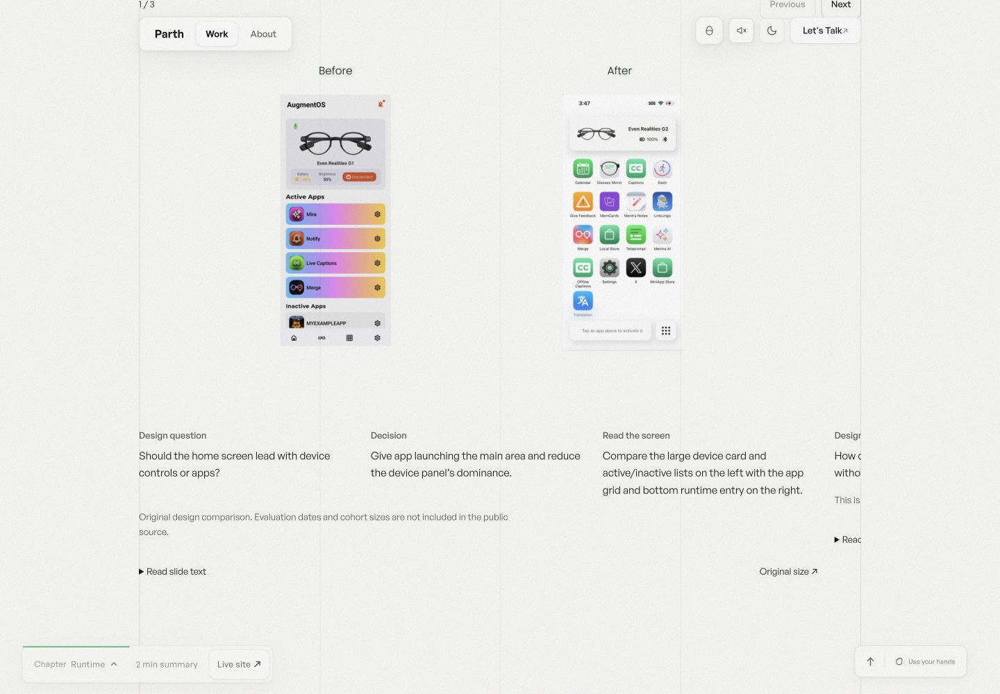

**V08 · mentra-decisions-mobile-dark.png**

The evidence and its captions stack into a readable sequence. Controls expose the selected slide and available next step.

Tiny text inside the original slide still needs the text alternative and original-size route. A photograph or screenshot alone cannot prove a usability outcome. [Source page](https://designwhich.works/mentra/#decision-first-use).

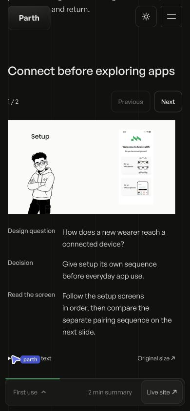

**V20 · mentra-original-home-before.png**

The earlier screen lets a reader identify the dominance of device information and the division between active and inactive apps.

This is comparison evidence, not a recommended starting style. It does not establish the results of testing. [Source page](https://designwhich.works/mentra/).

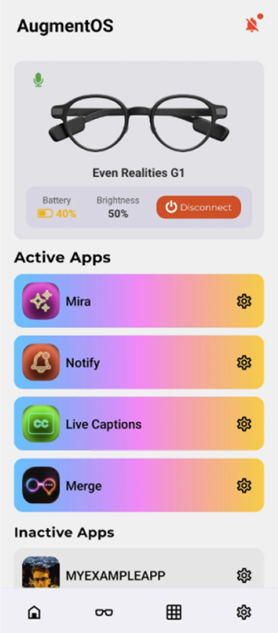

**V21 · mentra-original-home-after.png**

The later screen gives app launching more space and consolidates the device area. Compare it with V20 to see the hierarchy change.

Transfer the prioritization decision when relevant, not the icon artwork, shadows, exact layout, or implied release status. [Source page](https://designwhich.works/mentra/).

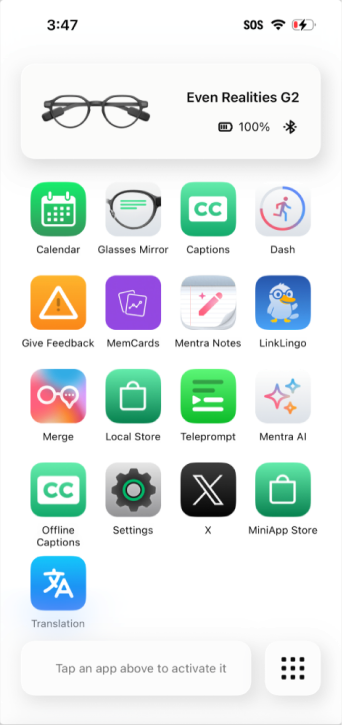

### Different project identities

**V09 · raahi-desktop-light.png**

One project image relates phone, kiosk, and vehicle touchpoints. The shared narrative frame can hold a different service identity.

This is a browser adaptation of a service concept. Its purple and dark screens are project-specific, not universal palette preferences. [Source page](https://designwhich.works/raahi-project/).

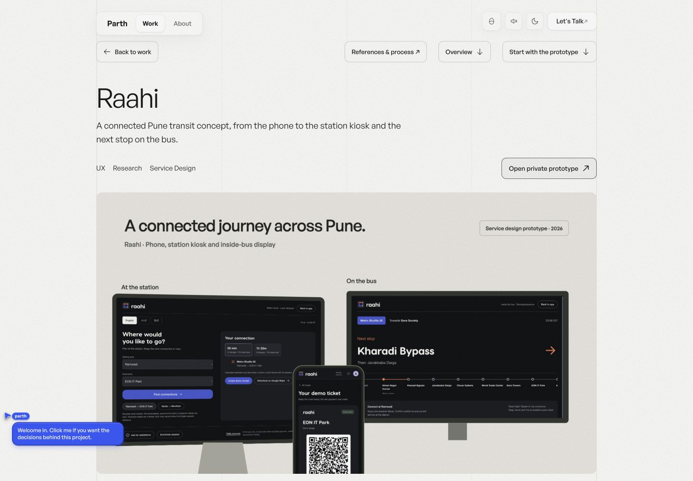

**V10 · transfi-desktop-light.png**

Financial information and a consumer widget retain their own blue identity inside the neutral portfolio shell.

Use the domain-specific information structure as context. Do not copy dashboard numbers, brand assets, or make claims about private functionality. [Source page](https://designwhich.works/transfi-project/).

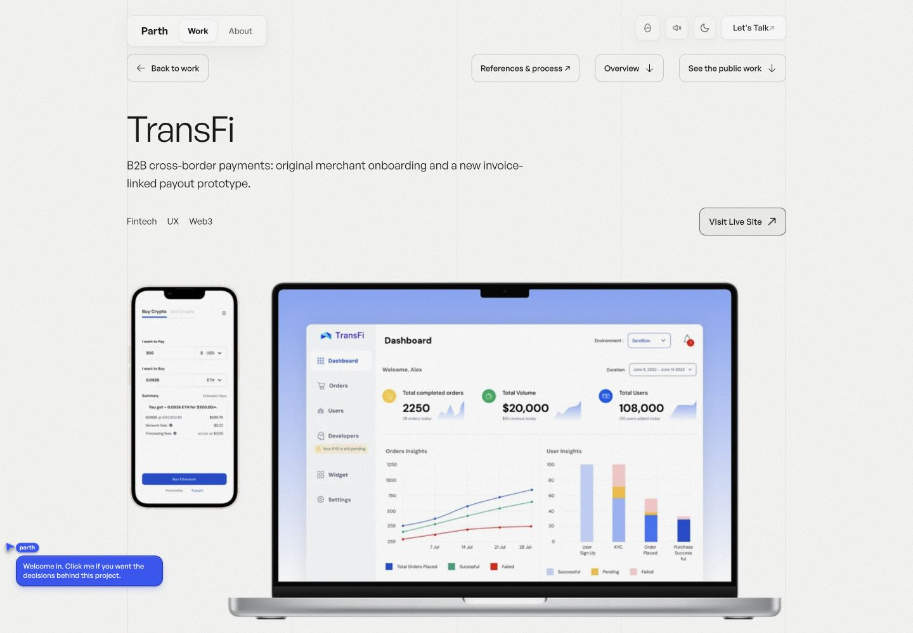

### Physical and material thinking

**V11 · jugalbandi-desktop-light.png**

A photograph shows the performer, instrument, and acoustic machine in the same scene. The subject supplies the strong color.

Stage lighting is content, not a default purple UI theme. Keep photography credits when using it publicly. [Source page](https://designwhich.works/jugalbandi/).

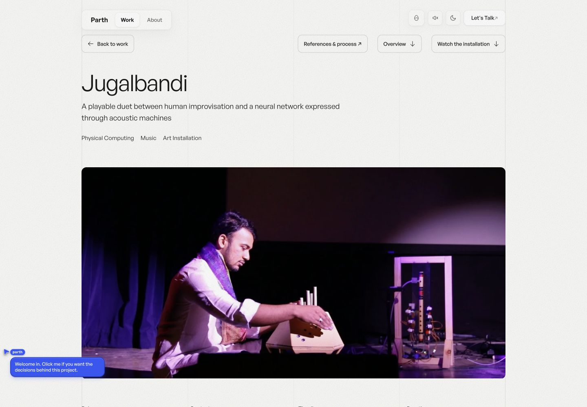

**V12 · enigma-original-sculpture.webp**

The tablet, spatial layers, wires, and lights make the relationship between input and represented computation visible.

A still image demonstrates physical arrangement, not recognition accuracy, timing, or visitor comprehension. Photo attribution must be checked before publication. [Source page](https://designwhich.works/enigma/).

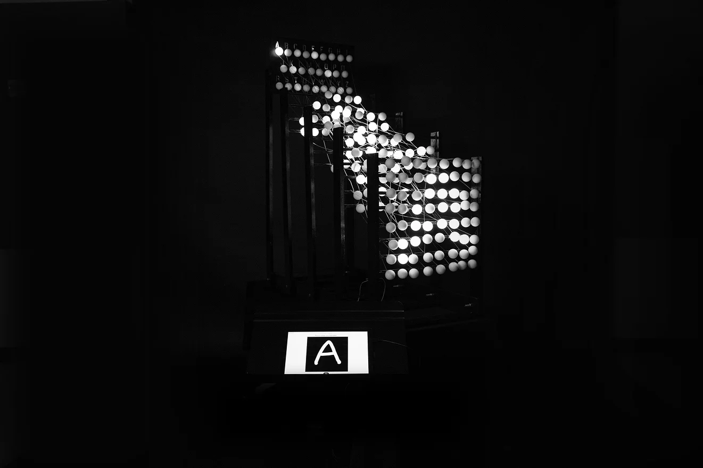

**V13 · jugalbandi-original-mechanism.webp**

Visible servos, wiring, picks, strings, and wood communicate how the object is built. Craft includes the mechanism, not only the finished enclosure.

Use it to study material and mechanism legibility. It is not a prompt to decorate unrelated UI with exposed wires or wooden textures. [Source page](https://designwhich.works/jugalbandi/).

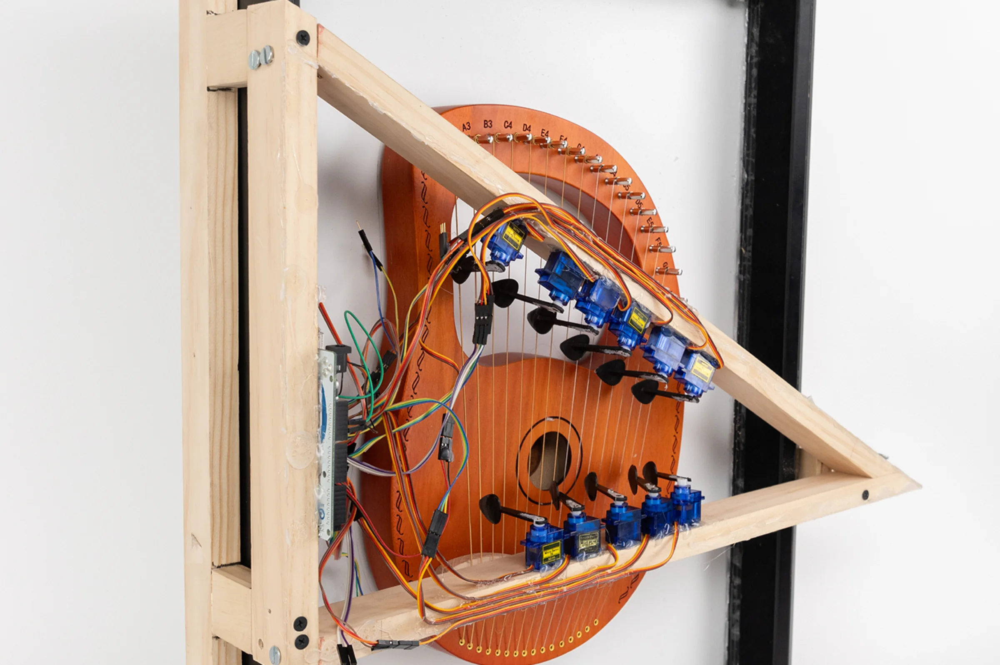

### Typography and construction

**V14 · typeface-desktop-light.png**

The specimen has its own graphic composition and color; the portfolio frame remains recognizable.

The purple cover belongs to this artifact. The typeface is a display study, not a required body or UI font. [Source page](https://designwhich.works/typeface/).

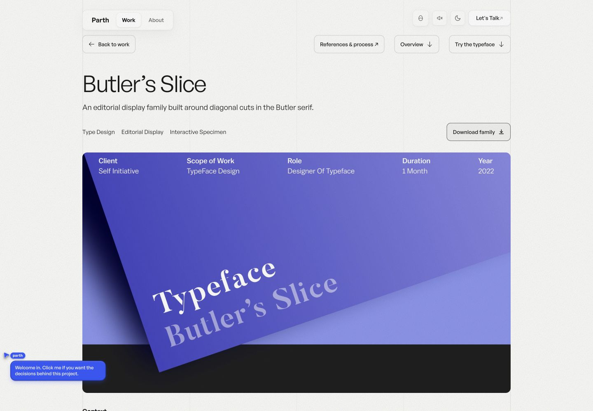

**V15 · typeface-original-slice-types.jpg**

Angle, vertical, and linear cuts form a repeated construction idea across different letterforms. Large specimens make the detail inspectable.

The artifact includes its original copy and layout. Study consistency of construction without reproducing its writing or treating this font as a general UI choice. [Source page](https://designwhich.works/typeface/).

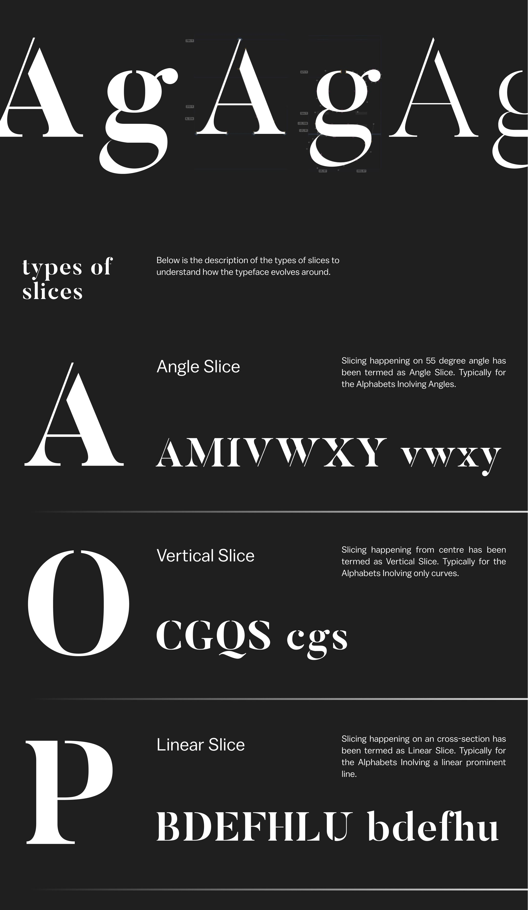

**V16 · typeface-original-inspiration.jpg**

A knife and carved surface connect the visual idea to a specific material gesture. The reference explains why the letterform intervention exists.

The embedded inspiration photography has its own attribution requirements. Use this as a record of the project’s references, not as a licensed stock asset. [Source page](https://designwhich.works/typeface/).

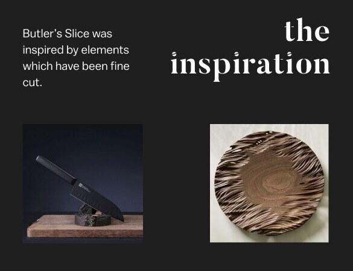

### Purposeful play

**V17 · graveyard-desktop-light.png**

The archive metaphor has a complete visual setting, object language, and tone of voice. Play grows from the subject.

The inscription text is too small and subdued to use as a legibility reference. Preserve the coherent idea while improving essential reading. [Source page](https://designwhich.works/graveyard/).

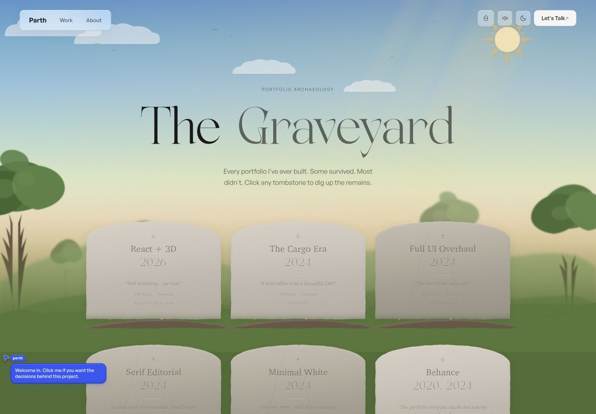

**V18 · graveyard-desktop-dark.png**

The same archive changes its atmosphere from day to night, showing how a coherent concept can support expressive theme variation.

Use for atmosphere only. The captured title and metadata have readability concerns; do not copy their low contrast. [Source page](https://designwhich.works/graveyard/).

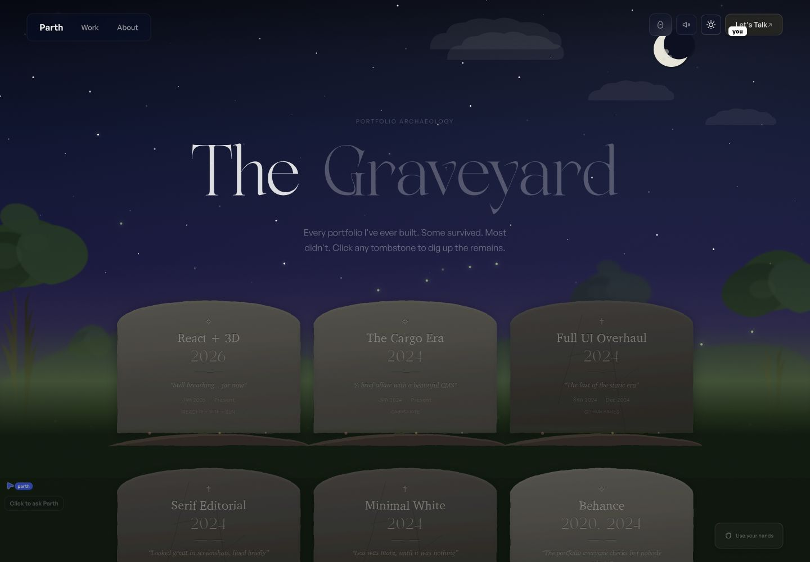

**V19 · playbook-after-category-desktop-dark.png**

The intended hierarchy pairs editorial headings with small labels, project links, and an object illustration for each idea.

This capture followed category navigation because direct entry was broken. The image is useful for intended hierarchy, not evidence that route loading is correct. [Source page](https://designwhich.works/playbook).

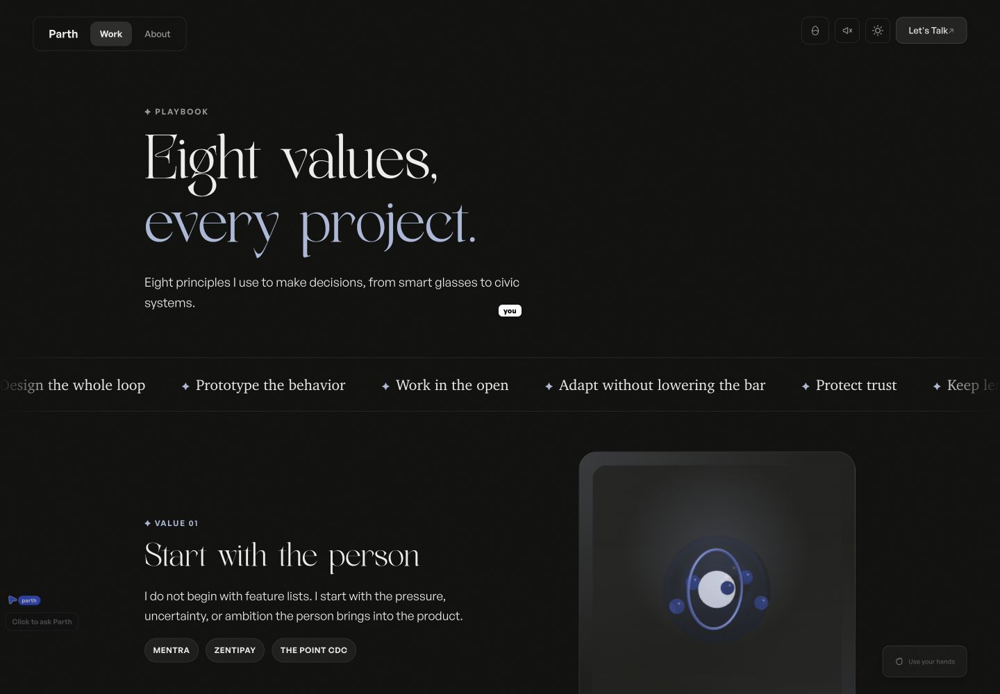

### Captured issues to avoid

**C01 · home-mobile-light.png**

A large reserved scene area pushes the introduction down on a 390px-wide screen.

Use as a spacing counterexample. Preserve expressive form while bringing the task and content into a stronger relationship. [Source page](https://designwhich.works/).

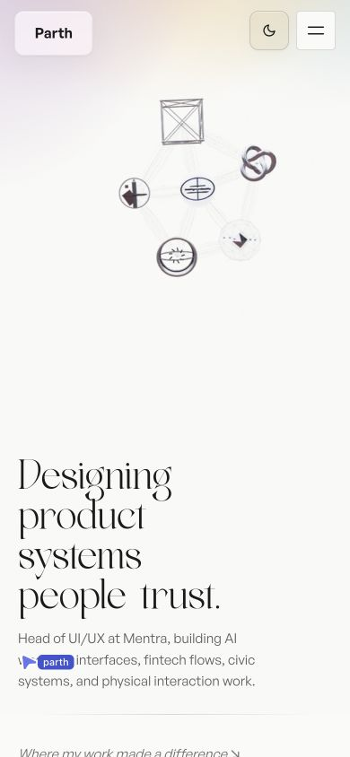

**C02 · playbook-mobile-light.png**

Direct-entry styling failed in this capture, leaving navigation over the heading and compressing the content hierarchy.

Do not copy the small title, unstyled links, or overlap. V19 records the intended hierarchy after the missing styles loaded. [Source page](https://designwhich.works/playbook/).

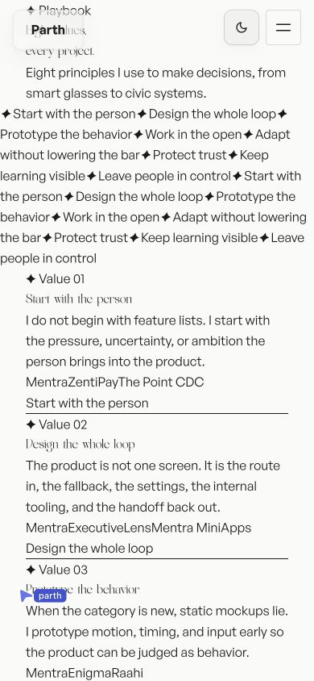

**C03 · typeface-mobile-specimen-light.png**

The full specimen splits weight names within words and has a lower navigation surface over the specimen area.

Keep functional labels intact and protect editable content from persistent controls. The typeface concept itself remains a positive reference. [Source page](https://designwhich.works/typeface/#tf-playground).

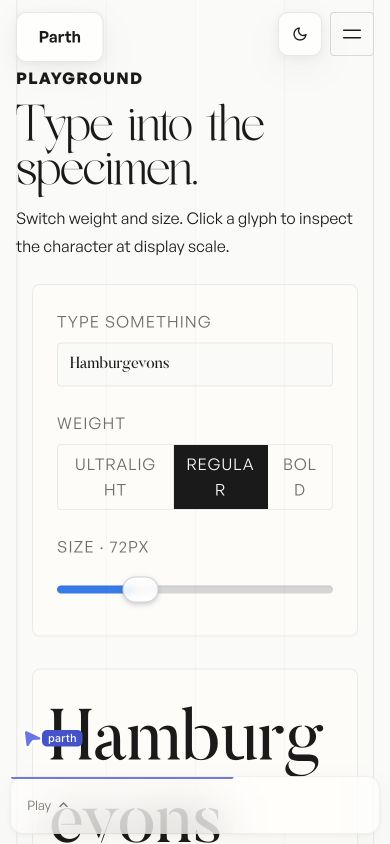

## Reference boundaries

Use these images to guide design decisions and comparisons. They do not authorize copying client branding, project claims, photographs, or fonts into another product. Check original credits and font/image rights if an assignment actually calls for reusing an asset. Source images can establish form and arrangement; timing, sound, recovery, and motion still need a working reference or prototype.

New explicit preferences from Parth take precedence over inferred traits in the collection. Replace or annotate a reference when new evidence changes what it supports. Do not turn one project’s appearance into a universal rule.
